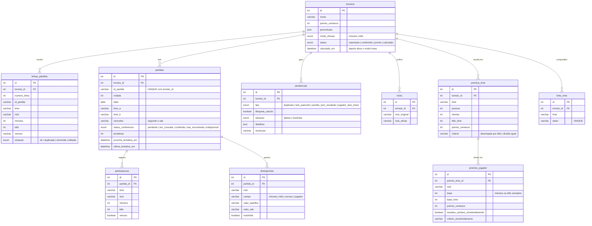

# Plano de construção

> Baseado no `contexto.md`. Este arquivo diz **como** e **em que ordem** construir.
> Regra de trabalho: uma etapa por vez. Cada etapa termina com **testes passando, o sistema rodando e um commit**. Só depois passo para a próxima.

---

## 1. Princípios

1. **Regra de negócio em funções puras**, sem banco nem HTTP. São as partes mais importantes e as mais fáceis de testar.
2. **Dinheiro sempre em centavos inteiros.** R$ 10.000,00 = `1000000`. Nunca `float`.
3. **O mínimo do desafio primeiro.** Etapas marcadas com ⭐ formam o caminho mínimo: subir planilha, conferir no site, ver quanto cada jogador recebe com filtro por nick.
4. **O site simulado é um serviço separado**, com a mesma lentidão e instabilidade do real. O sistema conversa com ele por HTTP, como faria com o site de verdade.
5. **A planilha original (`torneio-setembro.csv`) não é alterada.**
6. **Cada decisão nova vai para o `DECISIONS.md` no momento em que é tomada**, não no fim.

---

## 2. Visão geral

```
                ┌──────────────┐
  Maria Clara → │  Web (Vue)   │ ← jogadores (página pública e link do time)
                └──────┬───────┘
                       │ HTTP
                ┌──────▼───────┐        ┌────────────────────────┐
                │  API (Node)  │        │ Site oficial simulado  │
                │              │        │ (Node, porta própria)  │
                │  + job de    │──HTTP─▶│ 2 a 10 s por consulta, │
                │  conferência │        │ às vezes fora do ar    │
                └──────┬───────┘        └────────────────────────┘
                       │
                ┌──────▼───────┐
                │    MySQL     │  dados + tabela de tarefas da conferência
                └──────────────┘
```

Tudo sobe com `docker compose up`.

---

## 3. Bibliotecas (proposta, confirmar na etapa 0)

| Uso | Escolha | Por quê |
|---|---|---|
| Servidor HTTP | Express | Simples e muito conhecido; fácil de explicar |
| Acesso ao banco | Knex (migrations + query builder) | Migrations versionadas e SQL visível; quando precisar, escrevo SQL puro (a vaga pede SQL além do ORM) |
| Validação de entrada | Zod | Valida o que chega na API com tipos do TypeScript |
| Testes | Vitest | Rápido, funciona com TypeScript sem configuração extra |
| Front | Vue 3 + Vite + TypeScript | Stack escolhida |

---

## 4. Arquitetura do projeto

**Monorepo com três aplicações** (API, web e site simulado) e o banco MySQL, cada uma em seu contêiner.

### 4.1 API em camadas

Cada camada só conhece a de baixo. A regra de negócio fica no centro, sem depender de banco nem de HTTP.

```
Requisição HTTP
     │
     ▼
 rotas/          recebe a requisição, valida a entrada (Zod), devolve a resposta
     │
     ▼
 servicos/       orquestra o caso de uso: abre transação, chama o domínio e os repositórios
     │                         │
     ▼                         ▼
 dominio/        regras puras: leitura da planilha, pendências, classificação, divisão do prêmio
                 (não acessa banco nem rede; é onde ficam os testes principais)
 repositorios/   SQL com Knex; único lugar que conversa com o MySQL

 conferencia/    job em segundo plano (reserva partidas, consulta o site, gera divergências)
                 + cliente HTTP do site oficial, atrás de uma interface (pode virar Redis/SQS depois)
```

**Por que assim:** as regras que mexem com dinheiro ficam isoladas e testáveis sozinhas. Trocar o banco, a forma de rodar o job ou o site real mexe só nas bordas.

### 4.2 Estrutura de pastas

```
desafio-powerrev/
├─ api/
│  ├─ src/
│  │  ├─ rotas/
│  │  ├─ servicos/
│  │  ├─ dominio/
│  │  ├─ repositorios/
│  │  ├─ conferencia/
│  │  └─ banco/            conexão e migrations
│  └─ test/
├─ site-oficial-simulado/   serviço falso do site oficial (dados + modo demonstração)
├─ web/
│  └─ src/
│     ├─ paginas/           telas: torneio, importação, conferência, pendências, resultado, página pública
│     ├─ componentes/
│     └─ servicos/          chamadas à API
├─ testes/                  planilhas de teste, dados do site e resultados esperados
├─ docker-compose.yml
├─ contexto.md · plano.md · README.md · DECISIONS.md
```

---

## 5. Banco relacional (rascunho, ajustar na etapa 3)



**Pontos de destaque:**
- `partidas` é também a **tabela de tarefas** da conferência: `status_conferencia`, `tentativas` e `proxima_tentativa_em` controlam o job, como na janela de envio.
- `linhas_planilha` guarda **o que a Maria digitou**; `participacoes` guarda **o que o site registrou**. A comparação entre as duas gera as `divergencias`.
- Valores em dinheiro sempre em `int` de centavos.

---

## 5.1 Fluxo de branches (git)

> **Todos os commits e pushes são feitos pela Adrielly.** Eu sugiro mensagens; nada é commitado sem permissão.

```
main        ●──────────────────────────────────────●  v1.0.0 (entrega)
             \                                    /
develop       ●──────────────────────────────────●
               \                                /
feature/        ●──●──●──●──●──●──●──●──●──●──●
premiacao-torneios   (um commit pequeno por passo de cada etapa)
```

| Branch | Para quê | Regra |
|---|---|---|
| `main` | Versão entregue | Só recebe merge de `develop` no fim, com a tag `v1.0.0` |
| `develop` | Integração | Recebe a implementação completa por **pull request** |
| `feature/premiacao-torneios` | Toda a implementação | Sai de `develop`; cada etapa do plano vira uma sequência de commits pequenos |

**Por que uma branch só:** é um projeto de uma pessoa, com prazo de 7 dias; uma branch por etapa acrescentaria cerimônia sem ganho. A evolução fica visível nos commits.

**O pull request para `develop`:** como reúne tudo, a descrição precisa ser caprichada: o que foi construído, as decisões principais (com link para o `DECISIONS.md`), como rodar e como testar. Revisar o próprio diff antes do merge. Merge **sem squash**, para manter os commits visíveis.

**Mensagens de commit** no padrão Conventional Commits, em português: `feat:`, `fix:`, `test:`, `docs:`, `refactor:`, `chore:`. Exemplo: `feat: divide prêmio por minutos com centavo para quem jogou mais`.

---

## 6. Etapas

### Etapa 0 — Esqueleto ⭐
- Repositório git, pastas, `docker-compose.yml` com MySQL.
- API respondendo `GET /saude`; Vue abrindo uma página inicial.
- Knex com a primeira migration; Vitest rodando um teste de exemplo.

**Pronto quando:** `docker compose up` sobe tudo e `npm test` passa.

### Etapa 1 — Regras de negócio puras ⭐ (a mais importante)
- **Leitura da planilha:** BOM, CRLF, separador `;` ou `,` (D14), validação de colunas obrigatórias, conversão de data, `sim`/`não`/vazio.
- **Pendências locais:** linha duplicada (D6), nick com caixa diferente (D7), jogador em dois times (D13), partida sem resultado (D5).
- **Classificação:** vitórias → kills do time → divisão igual em empate total (D2), com o critério registrado.
- **Divisão do prêmio:** por minutos ou kills (D1), em centavos, com o centavo que sobra para quem tem mais minutos/kills e depois ordem alfabética (D9). Soma sempre igual ao prêmio.

**Pronto quando:** testes cobrem todos os cenários de `testes/` e batem com `testes/esperado/`, incluindo o caso de Brasa.gg (R$ 1.029,77) e Fogaréu (R$ 1.029,76) e o empate do cenário 04 (R$ 2.500 para cada).

### Etapa 2 — Site oficial simulado ⭐
- `GET /partidas/:id` devolvendo os dados de `testes/site-oficial.json` e de setembro (D15: Falcões venceu a `#40923`).
- Demora aleatória de 2 a 10 segundos; "não encontrada" para ID inexistente; falhas configuradas por partida (`falhas_antes_de_responder`).
- **Modo demonstração:** botões para derrubar e religar o site, e demora curta opcional.

**Pronto quando:** consigo consultar uma partida, ver a demora, derrubar o site e ver o erro.

### Etapa 3 — Torneio e importação ⭐
- Criar torneio: nome, prêmio, percentuais e modo de divisão.
- Upload da planilha: salva as linhas, cria as partidas como **pendentes de conferência** e registra as pendências locais (usando a etapa 1).
- Tela: criar torneio e subir planilha; mostrar erros de arquivo (cenário 06a) com mensagem clara.

**Pronto quando:** subo a planilha de setembro e vejo 15 partidas pendentes, a duplicata de Pantera_X e a dúvida sobre `xxsniperxx`.

### Etapa 4 — Conferência em segundo plano ⭐
- Job que acorda periodicamente e reserva partidas com `SELECT ... FOR UPDATE SKIP LOCKED`, marcando `em_consulta`.
- Consulta o site, salva as participações oficiais, compara com a planilha e gera **divergências**.
- Falha → nova tentativa com intervalo crescente: 1, 2, 5 e depois 10 minutos (D10). Intervalos configuráveis, curtos no modo demonstração.
- Botão **"tentar agora"** com espera entre cliques; não cria consulta paralela, só antecipa a próxima tentativa.
- Tela de progresso: status por partida, "última tentativa às X, próxima às Y" (atualização por polling).

**Pronto quando:** com o site derrubado no meio, nada se perde; ao religar, tudo é conferido; duas execuções do job nunca pegam a mesma partida.

### Etapa 5 — Revisão das pendências
- Duplicata em amarelo, com editar e remover (D6).
- Nick parecido: "é a mesma pessoa?" (D7).
- Divergência lado a lado, planilha × site, destacada em cor (D4).
- Partida sem resultado no site: a Maria informa o que aconteceu (D5).
- Jogador em dois times: aviso informativo (D13).
- O botão de calcular só libera quando não há pendência que bloqueia.

**Pronto quando:** consigo resolver todas as pendências de setembro e de novembro pela tela.

### Etapa 6 — Cálculo e resultado ⭐
- Calcular: aplica as regras da etapa 1 sobre os dados do site; **trava o modo de divisão** (D1).
- Tela da Maria: classificação com a justificativa do desempate, prêmio por time e **prêmio por jogador com filtro por nick**.

**Pronto quando:** setembro mostra o empate triplo resolvido por kills e os valores conferem com o cálculo manual. Corvos fica em 2º (368 kills). O 3º lugar depende das kills que o site registrar para Falcões na `#40923`: Falcões tem 248 nas outras partidas, então com 63 ou mais ultrapassa Tubarões (310). Esses números são definidos na etapa 2.

### Etapa 7 — Página pública e links por time premiado
- Página pública: classificação, regras, desempate e prêmio por time, sem valores individuais (D11).
- Link com token para cada time premiado: extrato de cada jogador, a conta, o centavo de arredondamento e filtro por nick.

**Pronto quando:** abrindo o link de um time, vejo só os jogadores dele; sem token, só a página pública.

### Etapa 8 — Documentação ⭐
- `README.md`: como rodar (um comando), por que essa stack, como usar o modo demonstração.
- `DECISIONS.md`: decisões, alternativas descartadas e o que ficou de fora e por quê (base: seções 11, 15 e 16 do `contexto.md`).
- Roteiro curto da demonstração para a sessão de retorno.

### Etapa 9 — Revisão final ⭐
- Clonar o repositório numa pasta nova e subir do zero seguindo só o README.
- Rodar todos os cenários de teste pela tela.
- Revisar o código como se fosse um code review de outra pessoa.

---

## 7. Cronograma (7 dias a partir de 13/10)

| Dia | Etapas |
|---|---|
| 1 | 0 e 1 |
| 2 | 2 e 3 |
| 3 | 4 |
| 4 | 5 |
| 5 | 6 e 7 |
| 6 | 8 |
| 7 | 9 e folga para imprevistos |

**Se o tempo apertar:** a etapa 7 vira só a tela da Maria com o filtro por nick, e a etapa 5 aceita resolver tudo com "usar o valor do site". Os cortes vão para o `DECISIONS.md`.

---

## 8. Checklist

- [ ] Etapa 0 — Esqueleto
- [ ] Etapa 1 — Regras de negócio puras
- [ ] Etapa 2 — Site oficial simulado
- [ ] Etapa 3 — Torneio e importação
- [ ] Etapa 4 — Conferência em segundo plano
- [ ] Etapa 5 — Revisão das pendências
- [ ] Etapa 6 — Cálculo e resultado
- [ ] Etapa 7 — Página pública e links por time
- [ ] Etapa 8 — Documentação
- [ ] Etapa 9 — Revisão final
