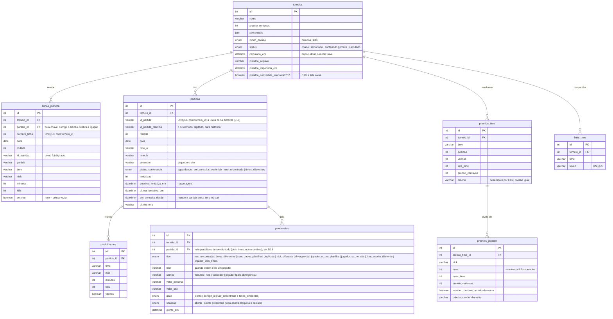

# Plano de construção

> Baseado no `contexto.md`. Este arquivo diz **como** e **em que ordem** construir.
> Regra de trabalho: uma etapa por vez. Cada etapa termina com **testes passando, o sistema rodando e um commit**. Só depois passo para a próxima.

---

## 1. Princípios

1. **Regra de negócio em funções puras**, sem banco nem HTTP. São as partes mais importantes e as mais fáceis de testar.
2. **Dinheiro sempre em centavos inteiros.** R$ 10.000,00 = `1000000`. Nunca `float`.
3. **O mínimo do desafio primeiro.** Etapas marcadas com ⭐ formam o caminho mínimo: subir planilha, conferir no site, ver quanto cada jogador recebe com filtro por nick.
4. **O site simulado é um serviço separado**, com a mesma lentidão e instabilidade do real. O sistema conversa com ele por HTTP, como faria com o site de verdade.
5. **A planilha original (`torneio-setembro.csv`) não é alterada.**
6. **Cada decisão nova vai para o `DECISIONS.md` no momento em que é tomada**, não no fim.

---

## 2. Visão geral

```
                ┌──────────────┐
  Maria Clara → │  Web (Vue)   │ ← jogadores (página pública e link do time)
                └──────┬───────┘
                       │ HTTP
                ┌──────▼───────┐        ┌────────────────────────┐
                │  API (Node)  │        │ Site oficial simulado  │
                │              │        │ (Node, porta própria)  │
                │  + job de    │──HTTP─▶│ 2 a 10 s por consulta, │
                │  conferência │        │ às vezes fora do ar    │
                └──────┬───────┘        └────────────────────────┘
                       │
                ┌──────▼───────┐
                │    MySQL     │  dados + tabela de tarefas da conferência
                └──────────────┘
```

Tudo sobe com `docker compose up`.

---

## 3. Bibliotecas (confirmadas)

Ambiente: Node 22, Docker 28, MySQL 8 via Docker (o `SKIP LOCKED` exige MySQL 8.0 ou superior). Monorepo com **npm workspaces**, sem ferramenta extra.

| Uso | Escolha | Por quê |
|---|---|---|
| Servidor HTTP | Express | Simples e muito conhecido; fácil de explicar |
| Acesso ao banco | Knex (migrations + query builder) | Migrations versionadas e SQL visível; quando precisar, escrevo SQL puro (a vaga pede SQL além do ORM) |
| Validação de entrada | Zod | Valida o que chega na API com tipos do TypeScript |
| Testes | Vitest | Rápido, funciona com TypeScript sem configuração extra |
| Front | Vue 3 + Vite + TypeScript | Stack escolhida |

---

## 4. Arquitetura do projeto

**Monorepo com três aplicações** (API, web e site simulado) e o banco MySQL, cada uma em seu contêiner.

### 4.1 API em camadas

Cada camada só conhece a de baixo. A regra de negócio fica no centro, sem depender de banco nem de HTTP.

```
Requisição HTTP
     │
     ▼
 rotas/          recebe a requisição, valida a entrada (Zod), devolve a resposta
     │
     ▼
 servicos/       orquestra o caso de uso: abre transação, chama o domínio e os repositórios
     │                         │
     ▼                         ▼
 dominio/        regras puras: leitura da planilha, pendências, classificação, divisão do prêmio
                 (não acessa banco nem rede; é onde ficam os testes principais)
 repositorios/   SQL com Knex; único lugar que conversa com o MySQL

 conferencia/    job em segundo plano (reserva partidas, consulta o site, gera divergências)
                 + cliente HTTP do site oficial, atrás de uma interface (pode virar Redis/SQS depois)
```

**Por que assim:** as regras que mexem com dinheiro ficam isoladas e testáveis sozinhas. Trocar o banco, a forma de rodar o job ou o site real mexe só nas bordas.

### 4.2 Estrutura de pastas

```
sistemaConferenciaTorneios/
├─ api/
│  ├─ src/
│  │  ├─ rotas/
│  │  ├─ servicos/
│  │  ├─ dominio/
│  │  ├─ repositorios/
│  │  ├─ conferencia/
│  │  └─ banco/            conexão e migrations
│  └─ test/
├─ site-oficial-simulado/   serviço falso do site oficial (dados + modo demonstração)
├─ web/
│  └─ src/
│     ├─ paginas/           telas: torneio, importação, conferência, pendências, resultado, página pública
│     ├─ componentes/
│     └─ servicos/          chamadas à API
├─ testes/                  planilhas de teste, dados do site e resultados esperados
├─ docker-compose.yml
├─ contexto.md · plano.md · README.md · DECISIONS.md
```

---

## 5. Banco relacional (rascunho, ajustar na etapa 3)



**Pontos de destaque:**
- `partidas` é também a **tabela de tarefas** da conferência: `status_conferencia`, `tentativas` e `proxima_tentativa_em` controlam o job, como na janela de envio.
- `linhas_planilha` guarda **o que a Maria digitou**; `participacoes` guarda **o que o site registrou**. A comparação entre as duas gera as `pendencias`.
- **Uma tabela só para pendências** (antes eram `divergencias` e `pendencias` separadas): cada problema vira **um item**, com o lado a lado planilha × site (D17). A duplicata de Pantera_X é um item `duplicata`, e não também uma divergência de minutos.
- **Sem tabela de unificação de nicks:** como o cálculo usa o nick do site (D7), não há o que unificar.
- **Texto digitado à mão (nick, time, ID) com collation `utf8mb4_0900_as_cs`:** o banco diferencia acentos e maiúsculas e nunca junta "xxsniperxx" com "xXSniperXx" em silêncio.
- **Criadas na etapa 3a:** `torneios`, `partidas` e `linhas_planilha`. As demais (`participacoes`, `pendencias`, prêmios e links) entram nas etapas que as usam.
- Valores em dinheiro sempre em `int` de centavos.

---

## 5.1 Fluxo de branches (git)

> **Todos os commits e pushes são feitos pela Adrielly.** Eu sugiro mensagens; nada é commitado sem permissão.

```
main        ●──────────────────────────────────────●  v1.0.0 (entrega)
             \                                    /
develop       ●──────────────────────────────────●
               \                                /
feature/        ●──●──●──●──●──●──●──●──●──●──●
premiacao-torneios   (um commit pequeno por passo de cada etapa)
```

| Branch | Para quê | Regra |
|---|---|---|
| `main` | Versão entregue | Só recebe merge de `develop` no fim, com a tag `v1.0.0` |
| `develop` | Integração | Recebe a implementação completa por **pull request** |
| `feature/premiacao-torneios` | Toda a implementação | Sai de `develop`; cada etapa do plano vira uma sequência de commits pequenos |

**Por que uma branch só:** é um projeto de uma pessoa, com prazo de 7 dias; uma branch por etapa acrescentaria cerimônia sem ganho. A evolução fica visível nos commits.

**O pull request para `develop`:** como reúne tudo, a descrição precisa ser caprichada: o que foi construído, as decisões principais (com link para o `DECISIONS.md`), como rodar e como testar. Revisar o próprio diff antes do merge. Merge **sem squash**, para manter os commits visíveis.

**Mensagens de commit** no padrão Conventional Commits, em português: `feat:`, `fix:`, `test:`, `docs:`, `refactor:`, `chore:`. Exemplo: `feat: divide prêmio por minutos com centavo para quem jogou mais`.

---

## 6. Etapas

### Etapa 0 — Esqueleto ⭐
- Raiz do monorepo: `package.json` com npm workspaces (`api`, `web`, `site-oficial-simulado`), `.env.example`.
- `docker-compose.yml` com `mysql:8`, `api`, `web` e `site-oficial`; a API espera o MySQL ficar saudável (healthcheck).
- API em Express: `GET /saude` faz `SELECT 1` no MySQL e responde o status da API e do banco. Pastas das camadas já criadas.
- Knex com a primeira migration (só `torneios`; o esquema completo é da etapa 3). A API aplica as migrations ao subir; `npm run migrar -w api` faz o mesmo à mão.
- Vitest com um teste de exemplo no domínio (`formatarCentavos`).
- Site simulado: só o esqueleto, com `GET /saude`.
- Vue 3 + Vite: página inicial que chama `/saude` da API e mostra o status, provando que as três camadas conversam.
- `README.md` com "como rodar".

**Pronto quando:** `docker compose up` sobe tudo, a página mostra API e banco ok, e `npm test` passa.

### Etapa 1 — Regras de negócio puras ⭐ (a mais importante)
- **Leitura da planilha:** BOM, CRLF, separador `;` ou `,` (D14), validação de colunas obrigatórias, conversão de data, `sim`/`não`/vazio.
- **Comparação planilha × site:** recebe as linhas da planilha e a resposta do site de uma partida e devolve os itens de pendência, **um por problema** (D17): divergência de minutos, kills, vencedor ou jogador presente só de um lado (D4a), times diferentes (D4b), duplicata (D6), nick com caixa diferente (D7), jogador em dois times (D13). Partida zerada na planilha e preenchida pelo site não gera item (D3).
- **Arredondamento:** **uma função só** de divisão pelo maior resto (D9), em centavos inteiros: a parte fracionária é comparada como resto inteiro (`total × peso mod soma`), sem `float`. Empate na fração: ordem alfabética ignorando acentos e maiúsculas. Devolve também quem recebeu centavo, para o extrato.
- **Classificação:** vitórias → kills do time → divisão igual em empate total (D2), com o critério registrado; a divisão entre times empatados usa a função do maior resto.
- **Divisão do prêmio:** por minutos ou kills (D1), com a mesma função do maior resto. Soma sempre igual ao prêmio.

**Pronto quando:** testes cobrem todos os cenários de `testes/` e batem com `testes/esperado/`, incluindo o centavo de Escama no cenário 01 (R$ 880,96, contra R$ 1.029,76 para os outros Dragões), o de Sabiá em outubro (R$ 74,63), o empate do cenário 04 (R$ 2.500 para cada) e o resultado esperado de setembro, com Tuca em R$ 65,90 (`contexto.md`, seção 14).

### Etapa 2 — Site oficial simulado ⭐
- `GET /partidas/:id` (ID só com os números, `/partidas/40923`) devolvendo os dados de `testes/site-oficial.json` e de `api/test/fixtures/site-setembro.json` (D15: Falcões venceu a `#40923` com 62 kills). 404 `nao_encontrada` para ID inexistente; 400 para ID inválido. **(2a, feito)**
- Demora aleatória de 2 a 10 segundos (`SITE_DEMORA_MIN_MS`, `SITE_DEMORA_MAX_MS`); falhas configuradas por partida (`falhas_antes_de_responder`), respondendo 503 `indisponivel` até esgotar. **(2b, feito)**
- **Modo demonstração:** página `GET /demo` com botões para derrubar (com erro ou sem resposta) e religar; demora curta pelo `.env`. **(2c, feito)**

**Pronto quando:** consigo consultar uma partida, ver a demora, derrubar o site e ver o erro.

### Etapa 3 — Torneio e importação ⭐
- Criar torneio: nome, prêmio, percentuais e modo de divisão.
- Upload da planilha: salva as linhas e cria as partidas como **aguardando o site** (usando a leitura da etapa 1). Os itens de pendência só nascem na conferência, quando já há o lado a lado do site.
- Tela: criar torneio e subir planilha; mostrar erros de arquivo (cenário 06a) com mensagem clara.
- Na criação, validar os percentuais com `erroDosPercentuais` (D20: "Os percentuais precisam somar 100").
- **Confirmação ao subir planilha num torneio que já tem planilha (3c):** avisar que a planilha anterior e a conferência já feita serão substituídas, e pedir confirmação (D22).
- Ao escolher o modo **kills**, a tela avisa: *"Jogadores sem nenhuma kill não recebem prêmio. Se ninguém do time fizer kills, o prêmio do time é dividido pelos minutos."* (D21)

**Pronto quando:** subo a planilha de setembro e vejo 15 partidas aguardando o site; o cenário 06a é recusado com a coluna que falta.

### Etapa 4 — Conferência em segundo plano ⭐
Em três pedaços. **4a:** as peças da consulta, sem o job: cliente HTTP do site oficial atrás de uma interface (encontrada, não encontrada ou indisponível, com tempo limite configurável e maior que a demora máxima do site) e a função pura da próxima tentativa (D10). **4b:** o job, dentro do processo da API, com lote de 3 em paralelo, recuperação de partida presa (sem contar tentativa) e a tabela `participacoes`. **4c:** a tela de progresso (barra "X de N conferidas", aba "Aguardando o site" com o motivo e a próxima tentativa, atualização a cada 5 s que para sozinha) e o "tentar agora" por torneio (bloqueio de 30 s no banco, sem zerar a agenda). As abas "Conferidas" e "Pendências" ficam para a etapa 5.

- Job que acorda periodicamente e reserva partidas com `SELECT ... FOR UPDATE SKIP LOCKED`, marcando `em_consulta`.
- Consulta o site, salva as participações oficiais, compara com a planilha (função da etapa 1) e gera os **itens de pendência**. "Não encontrada" e "times diferentes" marcam a partida e não entram nas novas tentativas: só uma correção de ID consulta de novo (D5, D16).
- Falha → nova tentativa com intervalo crescente: 1, 2, 5 e depois 10 minutos (D10). Intervalos configuráveis, curtos no modo demonstração. **Conta como falha, e é tentada de novo:** resposta **503**, **site sem resposta** (tempo esgotado, o cliente precisa de um limite de tempo por consulta) e erro de rede; também outro código de erro (400, 500, 502...) e resposta fora do formato, com o motivo guardado para a tela (4a). Só 404 (não encontrada) não é tentado de novo.
- Botão **"tentar agora"** com espera entre cliques; não cria consulta paralela, só antecipa a próxima tentativa.
- **Reenvio da planilha durante a conferência (D22):** a partida pode ser apagada enquanto o job espera o site. Ao gravar o resultado, o job confere se a partida ainda existe e descarta a resposta se não existir. Testar esse caso.
- Tela de progresso: status por partida, "última tentativa às X, próxima às Y" (atualização por polling).

**Pronto quando:** com o site derrubado no meio, nada se perde; ao religar, tudo é conferido; duas execuções do job nunca pegam a mesma partida.

### Etapa 5 — Revisão das pendências
**5a (API):** listar pendências (bloqueantes e não bloqueantes) e Ciente, desfazer e "Ciente de todas". As pendências são calculadas na hora pela comparação; só os Cientes são gravados (tabela `cientes`, no lugar da tabela `pendencias` do rascunho do banco), pela chave de cada pendência. **5b (API):** correção do ID (`PUT /torneios/:id/partidas/:partidaId/id-partida`): a partida volta para a fila do zero; a duplicata mantém o Ciente pelo id interno da partida, e as pendências do site voltam sem Ciente. **5c (API):** o `GET /torneios/:id` diz se pode calcular (campo `calculo`, com as contagens de aguardando o site, bloqueios e sem Ciente), calculado na hora. **5d (web):** abas Conferidas, Pendências e Aguardando o site; cartões com planilha × site, Ciente/Desfazer, "Ciente de todas" com modal, recarga quando os dados mudaram, só leitura depois do cálculo. **5e (web):** "Corrigir ID" no cartão da pendência bloqueante (erros da API junto do campo, a sondagem volta a rodar, "#antigo → #novo (corrigido)" onde o ID aparece) e o aviso "pronto para calcular" no topo, com o que falta levando à aba certa.

- Tela com três abas (D17): **Conferidas**, **Pendências** e **Aguardando o site**.
- Divergência de minutos, kills, vencedor ou jogadores, duplicata, nick com caixa diferente e jogador em dois times: lado a lado, planilha × site, destacado em cor, com **"Ciente"** e **"Ciente de todas"** (D4a, D6, D7, D13).
- ID não encontrado ou de partida de outros times: campo para **corrigir o ID**, que consulta de novo só aquela partida (D4b, D5, D16). Nada mais é editável.
- Regra única: todo item de Pendências precisa de "Ciente" ou de correção. O botão de calcular só libera com Pendências e Aguardando o site vazias (D17).

**Pronto quando:** consigo resolver todas as pendências de setembro, de novembro e dos cenários 02 e 03 pela tela.

### Etapa 6 — Cálculo e resultado ⭐
- Calcular: aplica as regras da etapa 1 sobre os dados do site; **trava o modo de divisão** (D1).
- **Confirmação ao calcular:** avisar que, depois do cálculo, o modo de divisão e a planilha ficam travados, e pedir confirmação (D1, D22).
- Tela da Maria: classificação com a justificativa do desempate, prêmio por time e **prêmio por jogador com filtro por nick**.

**Pronto quando:** setembro mostra o empate triplo com a justificativa e os valores batem com o resultado esperado (`contexto.md`, seção 14): Lobos 1º (R$ 5.000), Corvos 2º por kills (368, R$ 3.000), Tubarões e Falcões empatados em vitórias e kills (310) dividindo o 3º lugar (R$ 1.000 cada).

### Etapa 7 — Página pública e links por time premiado
- Página pública: classificação, regras, desempate e prêmio por time, sem valores individuais (D11).
- Link com token para cada time premiado: extrato de cada jogador, a conta, o centavo de arredondamento e filtro por nick.

**Pronto quando:** abrindo o link de um time, vejo só os jogadores dele; sem token, só a página pública.

### Etapa 8 — Documentação ⭐
- `README.md`: como rodar (um comando), por que essa stack, como usar o modo demonstração.
- `DECISIONS.md`: decisões, alternativas descartadas e o que ficou de fora e por quê (base: seções 11, 15 e 16 do `contexto.md`).
- Roteiro curto da demonstração para a sessão de retorno.

### Etapa 9 — Revisão final ⭐
- Clonar o repositório numa pasta nova e subir do zero seguindo só o README.
- Rodar todos os cenários de teste pela tela.
- Revisar o código como se fosse um code review de outra pessoa.

---

## 7. Cronograma (7 dias a partir de 13/10)

| Dia | Etapas |
|---|---|
| 1 | 0 e 1 |
| 2 | 2 e 3 |
| 3 | 4 |
| 4 | 5 |
| 5 | 6 e 7 |
| 6 | 8 |
| 7 | 9 e folga para imprevistos |

**Se o tempo apertar:** a etapa 7 vira só a tela da Maria com o filtro por nick, e a etapa 5 fica só com "Ciente de todas" e a correção de ID, numa lista única em vez de três abas. Os cortes vão para o `DECISIONS.md`.

---

## 8. Checklist

- [x] Etapa 0 — Esqueleto
- [x] Etapa 1 — Regras de negócio puras
- [x] Etapa 2 — Site oficial simulado
- [x] Etapa 3 — Torneio e importação
- [ ] Etapa 4 — Conferência em segundo plano
- [ ] Etapa 5 — Revisão das pendências
- [ ] Etapa 6 — Cálculo e resultado
- [ ] Etapa 7 — Página pública e links por time
- [ ] Etapa 8 — Documentação
- [ ] Etapa 9 — Revisão final

---

## 9. Melhorias pendentes

Anotadas para depois, **sem implementar** por enquanto. Se não couberem no prazo, vão para o `DECISIONS.md` como "o que ficou de fora".

- ~~**Nova lista de torneios**~~: feita no pedaço visual, só com o que já existe. Ficam para as etapas 5 a 7: "precisam da sua atenção", régua de etapas, linha de detalhe de cada torneio e as ações "Revisar" e "Ver resultado" (lista no `DECISIONS.md`).
- **Excluir torneio.** Precisa definir antes, como regra de negócio: se pode excluir depois do cálculo (os links dos times já podem ter sido enviados) e se a tela pede confirmação.
